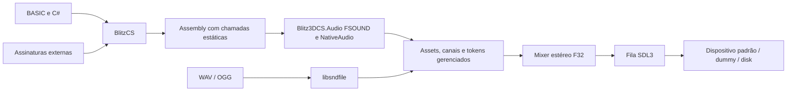

# M15 — áudio funcional do subconjunto SCP

O áudio deixou de apenas abrir dispositivo. `Blitz3DCS.Audio` agora decodifica
arquivos, mistura vozes e alimenta um stream SDL3 ligado ao dispositivo. Foram
executados samples e streams simultâneos, looping, volume, pan, frequência,
pausa, parada, liberação e reinicialização. Há PCM não silencioso capturado
**depois da fila nativa SDL**, além de testes determinísticos do mixer.
Isso não comprova compatibilidade completa com toda a FMOD 3.75 nem execução
do jogo ou audibilidade física confirmada por uma pessoa.

## Cobertura entregue

As 10 funções FSOUND com chamadas ativas no SCP e as 13 declarações auditadas
possuem bindings concretos no catálogo `samples/Audio/scp.json`:

| Grupo | Implementação e evidência |
|---|---|
| Init / Close | Dispositivo real, thread produtora, fila, encerramento e reinit; falhas retornam resultado/erro |
| Stream_Open / Play | Decoder WAV/Vorbis OGG, handles gerenciados, modo 2 em loop, seleção de canal livre |
| StopSound / Stream_Stop / Close | Interrupção, invalidação de canais, liberação de PCM e estado de stream |
| SetVolume / GetVolume / SetVolumeAbsolute | Ganho no mixer, leitura de estado; Absolute usa a escala padrão sem master-volume separado |
| SetPaused / IsPlaying | Pausa mantém canal ativo e posição; retomada continua reprodução |
| SetPan | Balanceamento estéreo aplicado ao PCM |
| Samples e comandos Blitz | LoadSound, PlaySound, FreeSound, ChannelPlaying/Volume/Pan/Pitch, Pause/Resume/StopChannel e defaults Sound*/LoopSound |
| Controles adicionais | Frequência positiva com reamostragem, posição e pontos de loop pelo runtime/mixer |

O [inventário](evidence/m15-api-coverage.json) relaciona os bindings concretos às
assinaturas auditadas. Nenhuma API FMUSIC foi acrescentada: não há uso no
snapshot. `PlaySound2`/`LoopSound2` são helpers BASIC do SCP que aplicam volume e
pan; suas consultas de entidades continuam pertencendo à futura engine.
`MusicPlayer.bb` contém um caminho OpenAL separado, não integrado ao Main auditado.
Não é fornecido um mock dele.

`FSOUND_Stream_Open` tem quatro argumentos no header/export original e três
no `.decls` do jogo. O método gerenciado aceita quatro, com `length=0` opcional;
o terceiro zero das chamadas originais funciona como offset zero. Isso preserva
as chamadas do fonte sem reproduzir uma pilha Win32 com aridade incorreta.

## Arquitetura, memória e execução



O compilador não referencia áudio, SDL ou codecs. Declaração sem implementação
continua verificável semanticamente e recusada no build quando usada.
`Audio_NotImplemented` mantém a demonstração negativa; nenhuma função de áudio
real foi substituída por um stub para obter emissão.

O decoder existente libsndfile é carregado dinamicamente, fora do gate do mixer.
Os formatos referenciados lexicalmente no fonte são OGG e WAV; a contagem não é
um inventário de todos os assets ou caminhos dinâmicos. Os `.it` sob GFX/items
são dados de itens, não justificam implementar FMUSIC. A biblioteca é LGPL;
[fonte primária de licença](https://libsndfile.github.io/libsndfile/#licensing).
Binários de SDL/libsndfile não são adicionados ao Git. O fixture sintético é CC0.

O produtor usa buffer fixo/pinado e fila limitada. Não há callback gerenciado no
thread nativo de áudio, reflexão por chamada ou codec executando no render.
O teste de render aquecido mede zero alocações gerenciadas. A sincronização de
controles/render ocorre no produtor, fora do callback SDL. A fila usa
[SDL_PutAudioStreamData](https://wiki.libsdl.org/SDL3/SDL_PutAudioStreamData),
que copia o buffer e mantém a conversão para o consumo do stream. A fila pode conservar
uma pequena cauda de PCM anterior após mudanças de controle.

Assets e canais usam tokens Int32 positivos e monotônicos; nenhum endereço x64
é convertido em Integer. Reusar slots não revive tokens antigos. O esgotamento
do espaço de tokens falha antes de começar uma voz não rastreada. O fechamento
invalida handles, solta recursos e aguarda a thread. Um número de sessão impede
que decodes iniciados antes de Close sejam publicados numa sessão reinicializada.
Falha do produtor invalida canais e exige Close/reinit para nova reprodução.
O stress exercita 10.000 plays/stops, recargas/liberações e ausência de pendências.

## Reprodução e PCM verificados

[Um asset real](evidence/m15-real-assets.json), `SFX/Door/DoorOpen1.ogg`, veio do
commit pinado Regalis11/scpcb, SHA-256
`ec32c710984ceae747f9e8cae60e2c00f8154bca4f2b22f37a1baa6d4c35b6e6`.
O decoder produziu 99.120 frames estéreo a 44,1 kHz. O arquivo não é redistribuído
no Git; testes reproduzíveis usam uma gravação sintética própria.

O [programa híbrido](../samples/Audio/playback.bb) executou com o asset real nos
backends dummy, padrão do host e disk. Em todos, sample e stream permaneceram
simultaneamente ativos e o teardown deixou **zero assets e zero canais**.
A [captura pós-SDL](evidence/m15-playback.json) contém 48.128 frames F32LE estéreo
44,1 kHz, RMS 0,0099758 e pico 0,0761947. Esses valores descrevem essa captura,
não limites de teste dependentes de timing. A prova inclui dados escritos pelo
backend nativo, não apenas contadores anteriores à fila.

Uma tentativa adicional de captura por sink privado Pulse ficou silenciosa.
A [investigação](evidence/m15-loopback/README.md) encontrou redirecionamento para
outro sink, inclusive com sinal de teste externo. Essas capturas não são prova de
silêncio do produto nem prova de playback. Não se alterou o EQ/default do usuário;
os sinks temporários foram removidos. A prova objetiva usada é o backend disk.
No driver padrão houve submissão de PCM ao dispositivo padrão selecionado pelo SDL; não houve confirmação
humana de som físico nem captura do monitor global de outras aplicações.

## Comparação com FMOD 3.75 original

O [probe genuíno](evidence/m15-fmod/README.md) usa o DLL original pinado em processo
Win32 x86 via Proton, com WAV gerado e assinatura StdCall de quatro argumentos.
Não carrega a DLL no .NET x64. Após restaurar a frequência nativa, um WAV de três
segundos continuou tocando depois de 3,3 s em modo 2; a evidência de loop não
confunde duração com reprodução em meia velocidade.

A [comparação executada](evidence/m15-fmod-comparison.json) contém **42 grupos de
observações: 34 coincidentes e 8 divergências documentadas, zero diferenças
inesperadas**. São grupos de retorno/estado/erro desse programa, não 42 fixtures
independentes. Normalizam-se somente identidades opacas não nulas/canais válidos;
os valores de retorno e erro permanecem intactos.

As oito diferenças são quatro operações sobre canal físico zero, dois estados
de erro após abertura bem-sucedida e duas frequências não positivas. O contrato
seguro aceita tokens retornados, não índices físicos. Frequência zero/reversa
não está implementada e falha explicitamente. O original pode deixar erro 14
ao abrir um stream válido; não se fabrica essa falha num decode bem-sucedido.
Fechar stream limpa o erro; Stop preserva o anterior no perfil observado.
Após fechar o dispositivo, IsPlaying retorna 0/erro 2; GetError retém 2, e reinit
funciona. Os testes também preservam a truncagem C++ nos adapters float Sound*.

O probe M14 continua em separado: cinco retornos Init coincidem, e as flags
0x80/0x80000000 aceitas no original continuam explicitamente recusadas. Não há
alegação de PCM bit a bit equivalente ao mixer/decoder original.

## Limites restantes e SCP

- Streams são pré-decodificados, não leitura incremental de disco; limite de
  256 MiB de PCM por arquivo, mono/estéreo. Não foi validado o conjunto completo
  de assets do jogo, caminhos dinâmicos ou memória de uma sessão completa.
- Perfil executado Linux x64, flags Init=0, 1..384000 Hz e até 4096 canais.
  Offsets de arquivo não zero, frequências zero/negativas e controles ALL não
  implementados falham explicitamente. Outras plataformas/RIDs não comprovados.
- A publicação é testada em diretório isolado com Audio.dll, SDL e libsndfile
  copiados; dependências nativas indiretas do sistema e licenças continuam a
  precisar de empacotamento por plataforma. Não é distribuição universal pronta.
- A árvore original permanece sintaticamente válida e o primeiro erro integrado
  continua `fullscreen_window_fix.bb:45:23`, `SystemProperty`. São **3/30** arquivos
  isolados com assembly. Os mesmos 30 hashes foram preservados; não há assembly
  integrado ou execução do jogo. Não se implementou outro subsistema para ocultar
  esse diagnóstico.

O [handoff](../handoff.md) lista os limites e alternativas para ampliar a
compatibilidade. O resultado é áudio funcional do perfil auditado, não uma
certificação de toda a FMOD nem uma declaração de que o áudio de uma sessão
completa do SCP já foi validado.

## Reprodução

```sh
PATH=/var/home/marcelo/.local/share/causoryn-dotnet:$PATH bash scripts/verify.sh
dotnet build BlitzCS.slnx -c Debug
dotnet test BlitzCS.slnx -c Debug --no-build
python3 tools/probe_audio_playback.py \
  --asset tests/Blitz3DCS.Audio.Tests/Fixtures/generated-tone.ogg \
  --capture-disk --report artifacts/m15-playback.json
python3 tools/compare_fmod_m15.py
```

O probe FMOD original requer SDK/DLL/Proton do ambiente anterior e
`tools/probe_fmod_m15.py --dll ... --report ... --evidence-dir ...`, com as
variáveis BLITZ3D_HOME/WINE/WINEPREFIX/DISPLAY documentadas no M13.
Resultados finais e hashes dos logs estão em `evidence/m15-validation.json`.

## Regressões finais

Builds Release e Debug terminaram com **zero avisos/erros** e **601 testes .NET
aprovados** em cada configuração (284 compilador, 262 CLI, 11 interop nativa,
44 áudio). Os 40 testes Python e as 86 fixtures locais passaram. As 85/86
coincidências de linguagem foram preservadas reutilizando os oráculos anteriores
com hashes de entrada conferidos; não foram recapturados esses 86 programas.
A divergência upper-bound-error permanece explícita. O stress anterior de objetos
BASIC repetiu 2×100.000 operações; o novo stress de canais exercita 10.000 plays/stops.
Os dados completos estão em [m15-validation.json](evidence/m15-validation.json).
